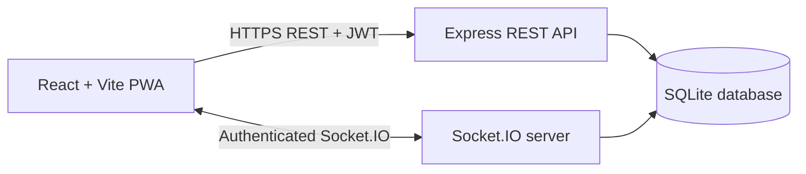

# FocusLock

FocusLock is a multiplayer study app for creating a study room, setting a small goal, and completing a synchronized focus sprint with classmates. The frontend is a React/Vite single-page app; the backend provides Express APIs, authenticated Socket.IO events, and SQLite persistence.

## Problem statement

Students often study together without a shared way to set goals, keep track of one another's focus, or review their work afterward. FocusLock provides a small, real-time study room with a synchronized timer and respectful focus feedback.

## Objectives

- Let authenticated students create or join a study room and declare a micro-goal.
- Keep sprint time, focus penalties, and final scores consistent by making the server authoritative.
- Support two focus modes with clear, non-punitive feedback.
- Save personal sprint history and calculate scorecards, badges, analytics, and streaks from SQLite records.
- Provide an installable web app shell without caching private or real-time data.

## Features

- Register, log in, and use authenticated real-time rooms.
- Create or join a study room, set personal goals, and let the host select sprint duration and Classic or Hardcore mode.
- Follow a server-controlled shared sprint timer. Hardcore mode pauses the sprint when a member leaves the page; Classic mode records distractions without pausing it.
- View focus status, distraction alerts, and squad health updates during the sprint.
- Review scorecards, complete goals, earn badges, and view history, analytics, study streaks, and the existing leaderboard.
- Install the frontend as a Progressive Web App (PWA) in supported browsers.

## Technology stack

| Area | Technology |
|---|---|
| Frontend | React, Vite, Tailwind CSS |
| PWA | `vite-plugin-pwa` and Workbox static precaching |
| Backend | Node.js, Express |
| Real-time | Socket.IO |
| Database | SQLite with `better-sqlite3` |
| Authentication | JWT bearer tokens and bcryptjs password hashing |
| Visibility | Browser Page Visibility API |
| Sound | Browser Web Audio API for the focus alert; original local ambient WAV samples |

## Requirements

- Node.js 22 LTS (or a newer supported LTS) and npm.
- A current browser. PWA installation requires HTTPS on a deployed site; `localhost` is treated as a secure origin for development.

## Run locally

Open a terminal in the project root, then install each package set:

```powershell
cd client
npm ci
Copy-Item .env.example .env
cd ..\server
npm ci
Copy-Item .env.example .env
```

Open `server/.env` and fill in `JWT_SECRET` with a private random value. The example leaves this value empty; the backend refuses to start until a valid secret is supplied. For example, generate one in PowerShell with:

```powershell
node -e "console.log(require('node:crypto').randomBytes(48).toString('hex'))"
```

Keep the generated value private. Do not put secrets in `client/.env`, commit either `.env` file, or share a secret in screenshots or logs.

Start the backend and frontend in separate terminals:

```powershell
cd server
npm run dev
```

```powershell
cd client
npm run dev
```

Open the Vite URL printed in the client terminal (normally `http://localhost:5173`). The backend uses port `3001` by default. The client environment defaults to localhost in development, and `GET /api/health` returns a small server health response.

## Environment configuration

### Backend (`server/.env`)

| Variable | Purpose | Example |
|---|---|---|
| `PORT` | HTTP and Socket.IO listening port | `3001` |
| `CLIENT_ORIGIN` | Exact browser origin(s) permitted by Express and Socket.IO CORS. Use comma-separated origins if there is more than one; do not add a path or use `*`. | `http://localhost:5173` |
| `JWT_SECRET` | Private secret used to sign and verify login tokens | Generate a private random value |

For production, set `NODE_ENV=production`, configure a non-empty `CLIENT_ORIGIN` for the deployed frontend, and use HTTPS. The server rejects startup in production if no allowed frontend origin is configured. The older `CLIENT_URL` variable remains accepted for existing local `.env` files, but new configuration should use `CLIENT_ORIGIN`.

### Frontend (`client/.env`)

| Variable | Purpose | Example |
|---|---|---|
| `VITE_API_URL` | Public base URL for the Express API | `https://api.example.edu` |
| `VITE_SOCKET_URL` | Public base URL for Socket.IO | `https://api.example.edu` |

For local development, both values can remain `http://localhost:3001`. If omitted in a production build, both default to the origin serving the frontend. `VITE_*` values are bundled into browser code: they are public configuration and must never contain credentials or secrets. Configure them before running the production build.

## Build and checks

```powershell
cd client
npm run lint
npm run build
```

```powershell
cd server
npm run check
npm audit --omit=dev --audit-level=high
```

The frontend audit can be run from `client` with:

```powershell
npm audit --omit=dev --audit-level=high
```

To inspect the built frontend locally, run `npm run preview` in `client` after a successful build.

## PWA behavior and cache boundaries

The production frontend build emits a web app manifest and a service worker. The worker precaches only built static frontend files (HTML, JavaScript, CSS, icons, and fonts; static audio files are included if shipped). It uses the SPA's `index.html` as the fallback for page navigation. It does **not** define runtime caching for API requests, login/authentication responses, user history, or Socket.IO traffic. Authentication and study data continue to come from the live backend.

In a supported browser, use its Install App / Install FocusLock browser-menu action after opening the HTTPS deployment (or `localhost`). Browser install UI differs by browser and operating system. A new version waits for the user to choose **Update now**; this avoids automatically reloading the app during an active sprint. Refreshing during a sprint leaves its current in-memory room.

The SVG icons under `client/public/icons/` are conspicuously marked **PLACEHOLDER** for development. Replace them with approved, polished product assets before presenting or distributing the PWA, retaining the required icon sizes and maskable safe area. Update their manifest paths and formats together if you replace SVGs with PNGs.

## Data storage and production preparation

SQLite is stored at `server/data/focuslock.db`; the server creates the data directory when it starts. The local database and its SQLite journal files are intentionally ignored by Git.

On first start, the server creates the required tables and seeds the five badge definitions. The main tables are:

- `users`: account name, unique case-insensitive email, and password hash.
- `rooms`: persisted room identity and host reference for completed sessions.
- `sprints`: unique session ID, mode, duration, start/end times, final squad health, and completion status.
- `sprint_members`: each participant's goal, distraction count, focus score, and goal-completion answer.
- `badges` and `user_badges`: badge definitions and per-user awards. A unique `(user_id, badge_id)` constraint prevents duplicate awards.

Foreign-key enforcement is enabled for the SQLite connection. The server uses a transaction to save a completed sprint and its members, with a unique sprint session ID to make repeated completion handling idempotent. Do not remove or replace `server/data/focuslock.db` for a presentation or deployment; back it up before maintenance.

Production hosting must provide persistent writable storage mounted at `server/data` (or preserve that directory between restarts). An ephemeral filesystem can erase accounts and study history when an instance restarts or is replaced. Back up the SQLite database regularly, and do not serve the `server/data` directory as public static content.

Before a production build, set `VITE_API_URL` and `VITE_SOCKET_URL` to the reachable backend origin. Configure the backend's `CLIENT_ORIGIN` with the exact frontend origin. Serve both frontend and backend over HTTPS, keep `JWT_SECRET` private, use persistent database storage, and configure the hosting platform's health check to use `GET /api/health`. This repository is prepared for deployment but does not deploy itself or select a hosting provider.

## Architecture



The server owns authentication, room rules, sprint timing, focus penalties, score calculations, streak and badge rules, and persistence. The browser presents server-returned state and sends user actions; it does not author final sprint scores or database records.

### Main API routes

Routes under `/api/auth` include registration, login, and the authenticated current-user check. Other authenticated routes include:

- `GET /api/history`
- `GET /api/analytics`
- `GET /api/badges`
- `GET /api/streaks`
- `GET /api/leaderboard`
- `GET /api/sprints/:sprintId/scorecard`
- `POST /api/sprints/:sprintId/goal-completion`

### Main Socket.IO events

Clients authenticate the Socket.IO connection with their JWT. Main client-to-server actions include `create-room`, `join-room`, `leave-room`, `set-goal`, `set-sprint-duration`, `set-sprint-mode`, `start-sprint`, `reset-sprint`, `user-distracted`, and `user-returned`. Server-to-client updates include room and sprint events, `focus-status-updated`, `squad-health-updated`, `focus-alert`, and `room-error`. The room host controls sprint setup; the server validates requests and broadcasts the resulting state.

## Focus visibility data flow

```text
User switches away from the FocusLock page
        ↓
Page Visibility API reports document.hidden
        ↓
React sends user-distracted through authenticated Socket.IO
        ↓
Node.js validates room membership, sprint state, and duplicate timing
        ↓
Server increments distraction count and reduces squad health
        ↓
Hardcore mode pauses the shared timer
        ↓
Socket.IO broadcasts the updated state to every room member
```

When all away members return, the server resumes a paused Hardcore timer. In Classic Mode, a distraction is recorded but the timer keeps running.

## Privacy and known limitations

FocusLock can detect only whether its own page becomes hidden or visible using the Page Visibility API. It does **not** inspect the external website a student visits, browser history, other tabs' content, or private information from another application. A focus alert reports that a member left the FocusLock workspace; it does not identify where they went.

The timer and room state live in server memory. A backend restart ends active in-memory rooms and sprints; completed sprint records remain in SQLite. Users need a working network and backend for login, multiplayer, scorecards, and saved data. The PWA offline mode caches only the static application shell; it is not an offline multiplayer or offline study-record mode.

The SVG PWA icons are marked **PLACEHOLDER** and should be replaced before public distribution. The three short ambient WAV loops in `client/public/audio/` are original procedural project assets and are served locally; no third-party tracks are bundled. Alert tones are generated by the browser and may require the user to enable them with an interaction because of browser audio policies.

The application does not guarantee that a browser, operating system, or device will expose an install prompt. Use a supported browser's Install App command on HTTPS (or localhost). SQLite is suitable for a single-instance student project, not concurrent multi-instance hosting.

## Final regression checks

Run `npm run lint` and `npm run build` in `client`, `npm run check` in `server`, and `npm audit --omit=dev --audit-level=high` in both folders. Final local regression checks covered temporary authenticated accounts, protected routes, authenticated Socket.IO, room creation/join/host reassignment/deletion, goals and host controls, both sprint modes, synchronized pause/resume and tab visibility, scorecard/goal completion, analytics, badges, streak, history, leaderboard privacy, and SQLite persistence across a backend restart. Dashboard, lobby, sprint, and scorecard layouts were checked at mobile, tablet, laptop, and desktop widths; dashboard panels were checked at mobile width. The production PWA shell and static audio assets were checked offline, and all temporary records were removed afterward.

Manual checks still recommended before an examiner presentation:

- Test on the actual two devices and Wi-Fi/network that will be used in the room.
- Install from a real supported browser on the final HTTPS deployment; localhost preview does not prove install availability on every device.
- Try ambient playback in the presentation browser and enable sound if prompted; the local procedural loops are bundled with the frontend.
- Keep a backup copy of the SQLite database before any presentation or deployment activity.

## Final examiner demo sequence

### Device A and Device B setup

1. On Device A, log in as Student A.
2. On Device B, log in as Student B. Use separate browser profiles if both devices are not available.

### Live demonstration

1. Device A creates a room. Show the generated room code and **HOST** badge.
2. Device B joins with that room code. Show the member list updating in real time.
3. Both students enter a micro-goal. Explain that each person declares what they plan to accomplish before starting.
4. The host selects **Hardcore Mode** and **1 Minute Test**.
5. Start the sprint. Show the same synchronized timer on both devices, Squad Health at 100%, and both students focused.
6. On Device B, switch to another browser tab. On Device A, show the Focus Interrupted alert, Device B as Away, its distraction count, reduced Squad Health, and the paused timer.
7. Return Device B to FocusLock. Show it returning to Focused and the timer resuming across both devices when everyone is back.
8. Let the sprint finish. Show **Sprint Completed** and the goal-completion question.
9. Submit goal completion. Show the server-backed Focus Score, goal status, distraction count, final Squad Health, and any newly earned badge.
10. Open Analytics, Study History, My Badges, and Leaderboard as the final dashboard demonstration.

### Demo failure backup

- **Wi-Fi or internet failure:** On one laptop, run the frontend and backend locally and demonstrate the complete app. For a two-device local-network demo, bind Vite to the LAN interface, set `VITE_API_URL` and `VITE_SOCKET_URL` to the host machine's LAN URL, set `CLIENT_ORIGIN` to the frontend's LAN origin, and allow the ports through the trusted private-network firewall. Do not expose the development server or database to a public network.
- **Second device cannot connect:** Use two separate browser profiles on the same laptop, each logged in as a different account. A room requires distinct user accounts.
- **Audio permission is blocked:** Keep the visual Focus Interrupted alert enabled and explain that the alert tone uses browser audio APIs. Audio is optional to the sprint; continue the demo without sound if the browser blocks playback.
- **PWA installation is unavailable:** Open the HTTPS web app normally and demonstrate the same application. Do not claim that it is installed.
- **Browser share API is unavailable:** Read the scorecard on screen; sharing is optional and not required for the sprint or its saved result.
- **Backend restarts during the demo:** Active in-memory rooms cannot be recovered; start a new sprint. Completed records remain in persistent SQLite if the host has configured durable storage.

## Likely lecturer questions

1. **Why React?** It lets the interface be built from reusable components whose display updates when room and sprint state changes.
2. **Why Node.js?** It uses JavaScript on the server as well as the client and has a mature ecosystem for web APIs and real-time connections.
3. **Why Socket.IO?** It provides event-based, low-latency updates for shared room state and reconnect handling over WebSocket-capable transports.
4. **Why SQLite?** It is simple to run for a university project, stores data in one persistent file, and supports transactions and constraints without a separate database service.
5. **Why JWT?** The server can verify a signed bearer token on API and Socket.IO connections without storing a server-side login session. A token is sensitive and should be kept private.
6. **How does tab detection work?** The browser's Page Visibility API tells the FocusLock page when it becomes hidden or visible; the app sends that change to the server during a sprint.
7. **Can FocusLock know which website was opened?** No. It knows only that the FocusLock page was hidden; it does not inspect browser history or other tab contents.
8. **Why is the timer controlled by the server?** One server clock and server-issued end time reduce differences between participants and prevent clients from deciding official sprint results.
9. **What is the difference between Classic and Hardcore?** Classic records distractions while time continues. Hardcore pauses the shared timer until every away member returns.
10. **How are duplicate penalties prevented?** The client tracks whether it is already away, and the server ignores events for an already-away member and events arriving too quickly after a previous distraction.
11. **How is Focus Score calculated?** For each member it is `max(0, 100 - 10 × their distraction count)` at completion.
12. **How are passwords protected?** Passwords are hashed with bcryptjs before being stored. Login compares the submitted password with the stored hash; the hash is not returned by account APIs.
13. **What happens if the server restarts?** Active rooms and timers are in memory and end; completed accounts, sprint history, badges, and other saved records remain in SQLite when its storage is persistent.
14. **Why use a PWA?** A PWA can be installed from a compatible browser and can load its cached static interface quickly; authentication and multiplayer still require the backend.
15. **What are the current limitations?** PWA icons are placeholders, offline multiplayer is not supported, active rooms are not recovered after a server restart, and browsers may block audio until the user interacts with the page.

## Future improvements

Possible later work includes final branded PWA icons, higher-fidelity rights-cleared ambient recordings, more robust recovery for active rooms, automated repeatable end-to-end tests, database backups/retention tools, and deployment-specific monitoring. These are not required for the current live demo.

## Examiner demo checklist (quick reference)

1. Register two test accounts in two browser profiles or separate devices.
2. In the first account, create a room, choose a short test sprint and mode, set a goal, and start it.
3. Join with the second account and demonstrate the shared room/member state.
4. During a Hardcore sprint, switch one browser tab away and back; show the focus status, alert, squad health, and pause/resume behavior.
5. Run a Classic sprint and show the timer continuing after a tab switch.
6. Complete a sprint, submit goal completion, and review the scorecard, badges, history, analytics, streak, and leaderboard.
7. Restart the backend and verify that the account and completed sprint history remain available.
8. Open the deployed HTTPS frontend in a supported browser and install it using the browser's install command. Also test a narrow mobile viewport.

## Presentation summary

FocusLock is a React single-page app connected to an Express API and an authenticated Socket.IO server. The server is authoritative for multiplayer rooms, synchronized sprint state, focus rules, and final scores. SQLite stores accounts, sprint history, badges, and related records. The frontend can be installed as a PWA and caches only static app assets; all private data and real-time features still require the backend.
